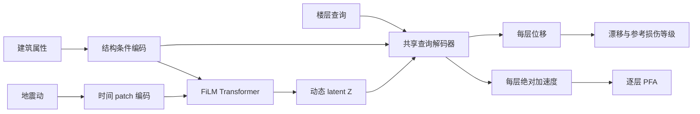

# Stage 1 模型设计

状态：O2 核心模型已建立；前向/反向与实际预览数据接口通过。O1 完整小数据集仍待生成，O3 尚未开始。

## 输入和输出

| 项目 | 内容 | 张量形状 |
| --- | --- | --- |
| 地震动 | 50 Hz、SI 加速度，含有效自由衰减尾段 | `[B,T,1]` |
| 数值属性 | 层数 N、总高度 H、设防水平、初始周期 T1 | `[B,4]` |
| 类别属性 | 结构类型编码，不使用建筑 ID | `[B]` |
| 楼层查询 | 1 到 N；0 表示补齐位置 | `[B,F]` |
| 位移输出 | 每层相对地面位移，m | `[B,T,F]` |
| 加速度输出 | 每层绝对加速度，m/s² | `[B,T,F]` |

T 为保存网格的有效时程长度（含尾振）；F 为 batch 内补齐后的查询楼层数。
当前数据只覆盖同一类五层模型；类型词表和不同层数接口的支持不等于相关预测能力已验证。

## 模型 A：条件时序编码器

1. 地震动每 10 点组成一个 patch（50 Hz 时对应 0.2 s），线性投影到 128 维。
2. 加入以秒为坐标的正弦/余弦位置编码和 patch 有效比例，屏蔽无效补零。
3. 四项数值属性用固定工程尺度缩放后经 MLP 编码，结构类型使用类别 embedding。
4. 4 层 Transformer，4 个注意力头，FFN 宽度 512。建筑条件在每层通过 FiLM 调整特征。
5. 输出完整动态 latent 序列 Z；同时保留建筑条件表示 z_s。

3751 个时间点补齐至 3760 点，对应 `Z=[B,376,128]`。
latent 是可学习的动态特征；目前不赋予真实振型、模态坐标等物理名称。

## 模型 B：共享楼层查询解码器

1. 查询特征为楼层相对位置 i/N、楼层序号 i/20、是否顶层，再结合 z_s 编码。
2. 每层 query 对 Z 做 cross-attention，取得该层的响应上下文。
3. 该层上下文与每一个时间 token 融合，保留全时程信息。
4. 两个共享输出头分别生成每个 patch 的 10 点位移和 10 点加速度，拼接还原完整时程。

同一组参数处理所有楼层，可以查询单层、若干层或全部楼层。楼层查询顺序不改变对应楼层的输出。
不同建筑的楼层和时间均有 mask；无效位置输出为 0，不参与损失。
初版使用等层高模型，i/N 同时代表相对高度；逐层不等高需扩充查询特征，不能直接视为已支持。
时间输出仍与输入使用同一 50 Hz 网格；变采样率不在当前实现范围内。



## 联合训练和派生指标

两个模块一次前向、一次反向共同更新，不需要 latent 标签或先预训练其中一个模块。
顶层响应直接从全楼输出取顶层，不把预测顶层曲线串接到第二阶段。

初始损失：

`L = MSE(u / scale_u) + MSE(a / scale_a) + MSE(theta / scale_theta)`

每个 MSE 先按每栋建筑的有效时间/楼层求均值，再对建筑求均值。漂移由相邻层位移差除以实际层高计算，全层监督要求按 1..N 排序。
三个尺度使用训练分区的 RMS，保存来源和数值；不移除响应均值，不使用验证/测试标签拟合尺度。
当前实际数据检查拟合的尺度只服务 O2 接口检查；O3 必须从正式训练分区重新拟合。

输出再计算每层 PIDR/PFA、全楼最大值、危险层、逐层/全楼 DS_ref，以及顶层两条曲线。
DS_ref 使用显式漂移阈值，不设独立分类头。查询局部楼层时，不计算全楼指标或缺失相邻层的漂移。
峰值先在模型的保存网格上计算；与 MDOF 全积分网格峰值的差异另行评估。

## 本轮取舍

- 使用最小 FiLM Transformer 基线，暂不增加 FNO/FFT 分支、模态标签或额外全局指标预测头。
- patch 化将时间 token 数减少约 10 倍；latent 仍保留完整时间次序。
- 初版 1,097,492 个参数，dropout=0；先检验能否拟合，再根据验证结果调节。
- 完整地震动编码不是在线因果预测；先研究给定完整波形的快速全楼响应。

## 已完成检查

- 6 项自动检查通过：混合 3/5/8 层反向、补零值/补零长度影响、楼层查询重排/子集、损失与尺度掩码、解析漂移/等级/顶层提取、非法输入。
- 正式模型尺寸的 CPU 前向/反向通过：`[2,3751,1] → [2,376,128] → 两个 [2,3751,5]`。
- 三个实际五层预览算例完成数据接入；旧位移时间对齐修正、响应抗混叠降采样后在 50 Hz 网格监督。
- 结构编码器、时间编码器和楼层解码器均有非零、有限梯度。只检查一次反向，没有优化器更新。

证据：[model_check.json](reports/model_check.json)、[实际输入来源](reports/model_check_input.json)。这些结果不代表已经学会预测。

## 文件与复现

- `src/model.py`：模型 A/B。
- `src/losses.py`：训练尺度、掩码损失、漂移计算。
- `src/metrics.py`：响应派生指标。
- `configs/model.json`：当前模型配置。
- `scripts/prepare_model_check_input.py`：从实际预览 HDF5 准备接口检查输入。
- `scripts/check_model.py`：自动检查、正式尺寸和实际数据反向检查。

在 experiment 目录运行：

```powershell
$env:PYTHONDONTWRITEBYTECODE='1'
& '..\mdof-workbench\.venv\Scripts\python.exe' 'stage1\scripts\prepare_model_check_input.py'
& 'C:\software\conda\envs\ml\python.exe' 'stage1\scripts\check_model.py'
```

前一环境已有 numpy/scipy/h5py，后一环境已有 PyTorch/numpy。本轮未安装依赖或更改这些环境。全部新增代码、数据及记录均在 experiment 内。
