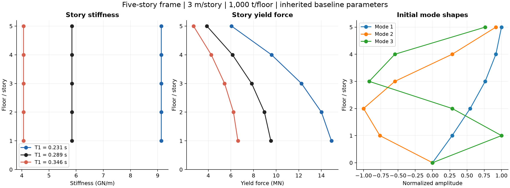
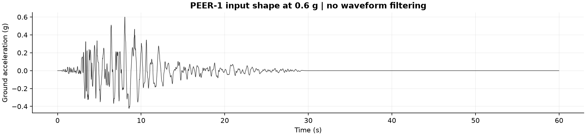
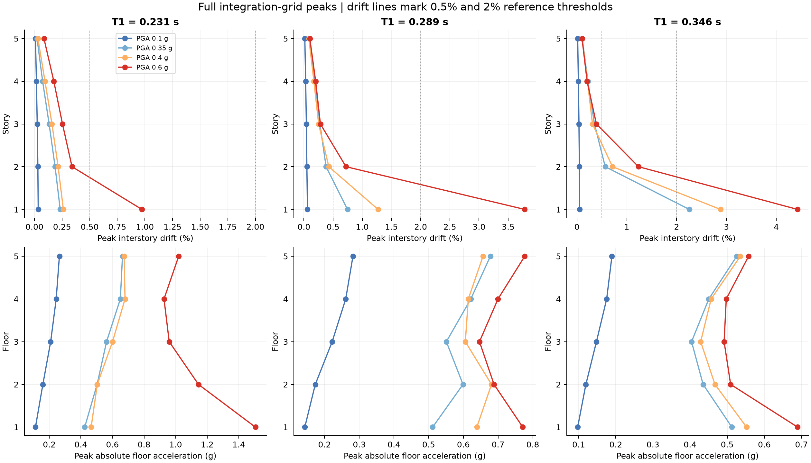
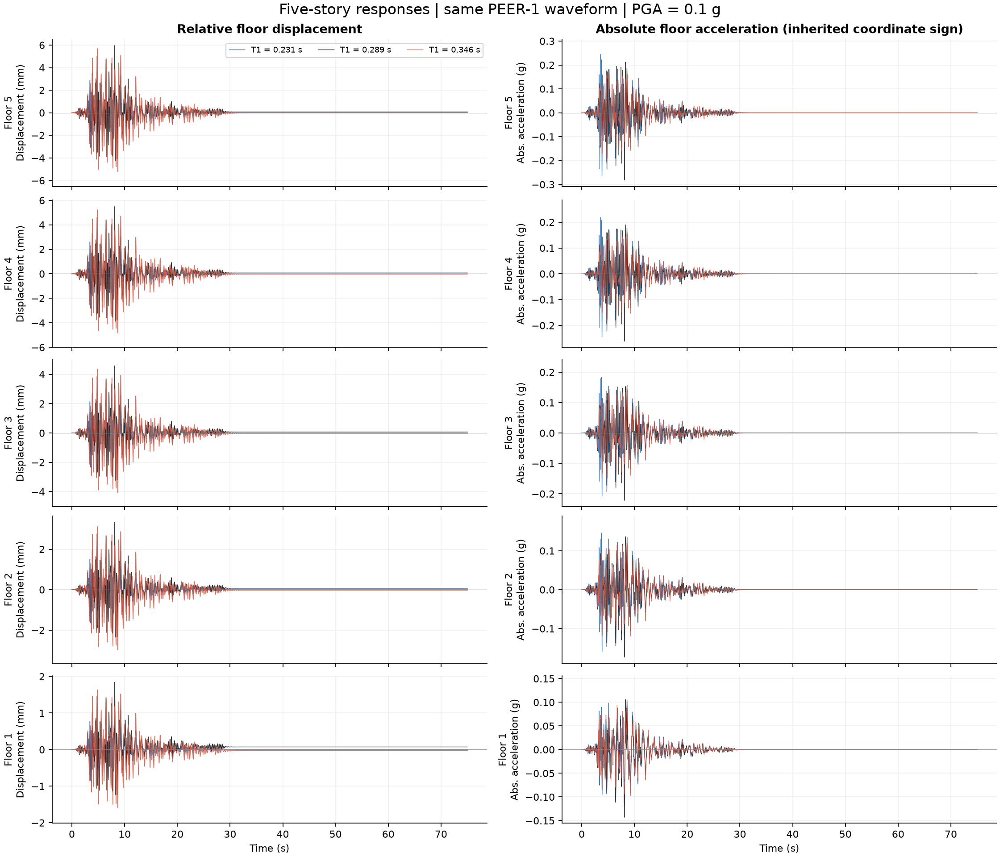
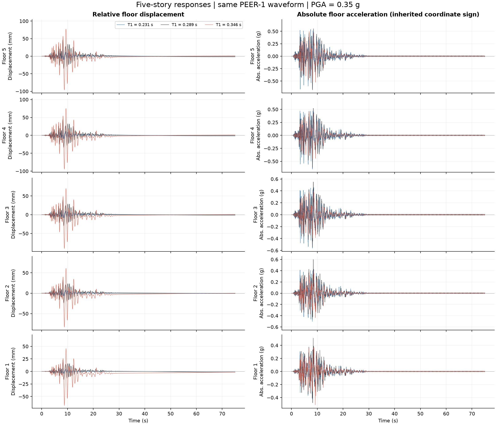
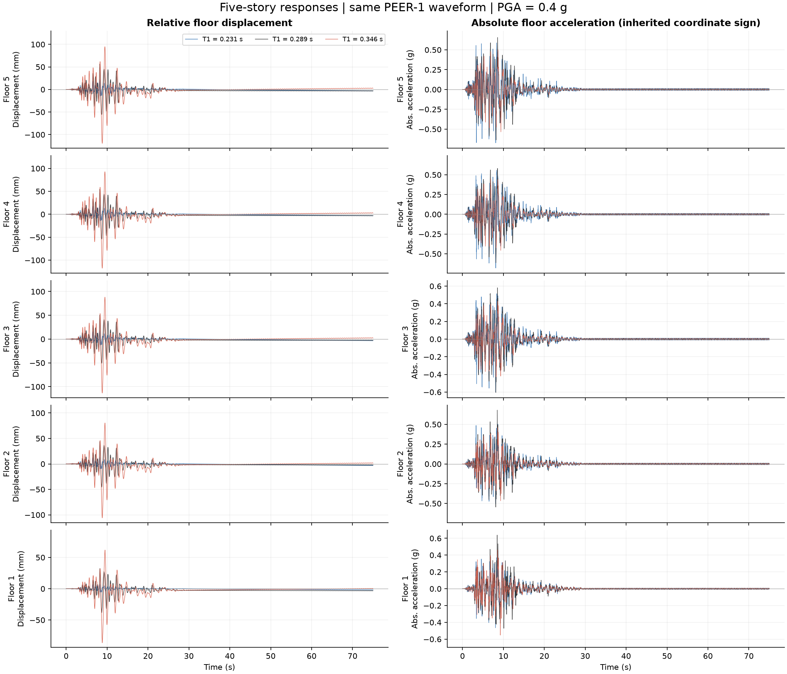
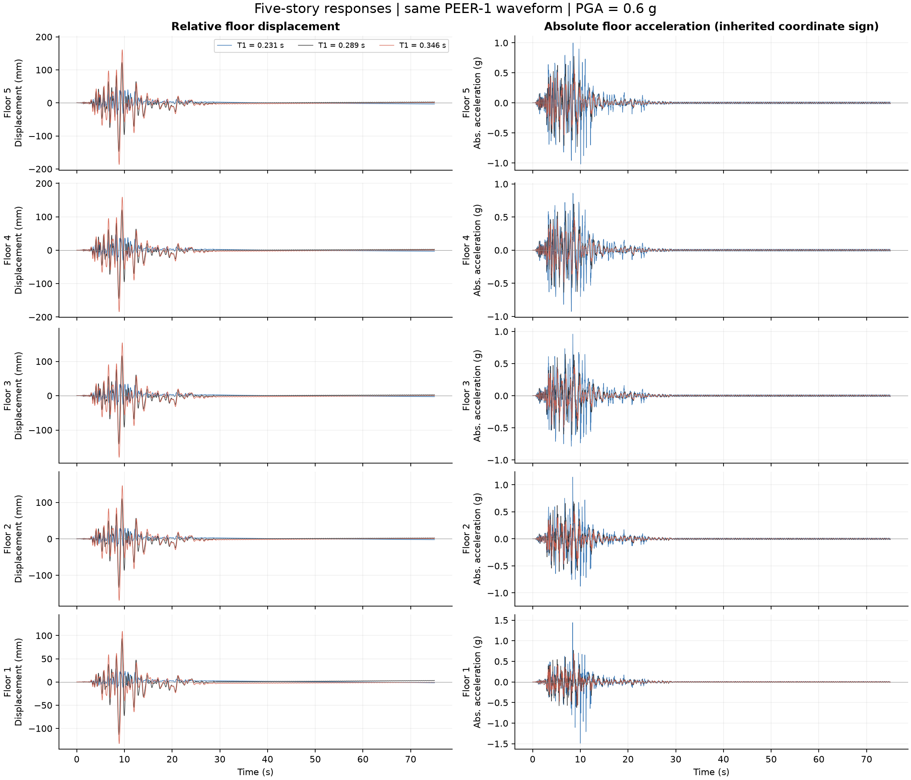
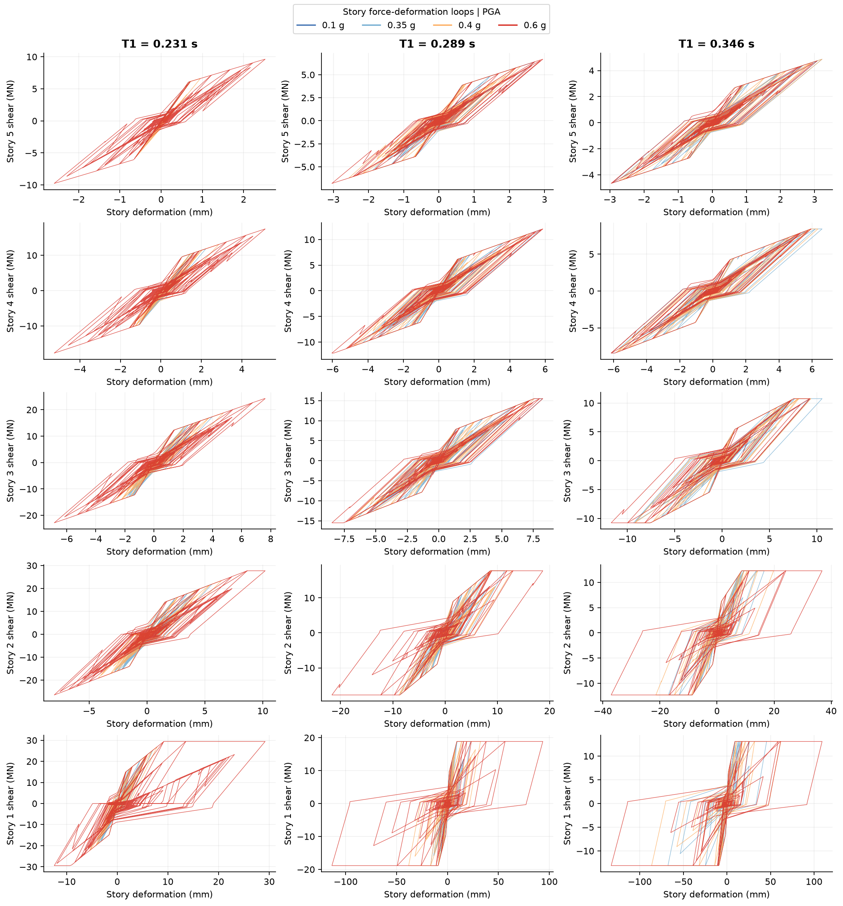

# 五层结构：不同 T1 与 PGA 的逐层响应预览

日期：2026-10-21。共 3 个结构 × 4 档 PGA = 12 个工况；所有响应由新 C++ 生产内核独立积分。

## 参数与模型

采用项目既有陆—曲十参数滞回模型和旧 0.1 兼容分支。按用户确认的既有标定与新版/旧版对照基础开展本轮计算；旧 EXE 只用于导出五层基准材料参数，不提供任何本轮响应。

基准属性：5 层、总高 15 m、层高 3 m、每层面积 1,000 m²、质量面密度 1,000 kg/m²（每层 1,000 t）、2002 年、8 度设防、框架、场地类别 2/分组 1。阻尼比 5%。材料参数由既有参数生成器按这些属性生成，未用演示参数替代。

三个版本的全部层刚度和屈服力同时乘以 1.5625、1、0.694444。屈服变形保持一致，周期变化同时伴随强度变化；只用于这组受控预览。初始振型相同。

| 版本 | T1 / s | 各层刚度 / GN·m⁻¹ | 刚度/强度倍率 |
| --- | --- | --- | --- |
| 0.8T | 0.230941 | 9.136875（1–5层相同） | 1.562500 |
| 1.0T | 0.288676 | 5.847600（1–5层相同） | 1.000000 |
| 1.2T | 0.346411 | 4.060833（1–5层相同） | 0.694444 |

| 层号 | 质量 / t | 层高 / m | 基准刚度 / GN·m⁻¹ | 基准屈服力 / MN | 屈服变形 / mm |
| --- | --- | --- | --- | --- | --- |
| 1 | 1000 | 3 | 5.8476 | 9.5295 | 1.6296 |
| 2 | 1000 | 3 | 5.8476 | 8.9641 | 1.5330 |
| 3 | 1000 | 3 | 5.8476 | 7.8333 | 1.3396 |
| 4 | 1000 | 3 | 5.8476 | 6.1370 | 1.0495 |
| 5 | 1000 | 3 | 5.8476 | 3.8753 | 0.6627 |

其余八个参数各层相同：`eta=0.21031, mu=1000, gama=0.4, esoft=-1e-06, alpha=1.9786, beta=1, a_k=0.4, Omega=0.1`。完整 15 行参数见 [structure_parameters.csv](structure_parameters.csv)。



## 地震动与强度

采用工作台已有的处理后 PEER-1 波形（50 Hz，3,000 点，末时刻 59.98 s；具体原始事件名未在该处理文件中声明）。每个强度均按实际绝对峰值缩放至目标 PGA；60.00 s 追加零激励，随后计算 15 s 自由衰减。所有版本使用相同波形。

最终四档为 0.10g、0.35g、0.40g、0.60g。先行试算选择这些幅值，使结果覆盖无/轻微/中等/严重参考损伤，并避免本组进入 5% 的显式材料失效截断。选幅属于预览设计，不用于模型独立测试。



## 结果

DS_ref 按 PIDR 严格超过 `[0.5%, 0.8%, 2%, 5%]` 的数量取 0–4：无、轻微、中等、严重、最高参考等级。它是本次明确采用的固定参考判据；材料失效标志另行保存。

| T1 / s | PGA / g | 全楼最大 PIDR / % | DS_ref | 顶层峰值位移 / mm | 全楼最大 PFA / g | 危险层 |
| --- | --- | --- | --- | --- | --- | --- |
| 0.231 | 0.10 | 0.0344 | 0 | 3.539 | 0.264 | 1 |
| 0.231 | 0.35 | 0.2333 | 0 | 19.480 | 0.664 | 1 |
| 0.231 | 0.40 | 0.2619 | 0 | 22.809 | 0.680 | 1 |
| 0.231 | 0.60 | 0.9731 | 2 | 48.967 | 1.505 | 1 |
| 0.289 | 0.10 | 0.0614 | 0 | 5.967 | 0.282 | 1 |
| 0.289 | 0.35 | 0.7469 | 1 | 46.596 | 0.678 | 1 |
| 0.289 | 0.40 | 1.2707 | 2 | 56.695 | 0.681 | 1 |
| 0.289 | 0.60 | 3.7833 | 3 | 147.197 | 0.777 | 1 |
| 0.346 | 0.10 | 0.0546 | 0 | 5.684 | 0.190 | 1 |
| 0.346 | 0.35 | 2.2550 | 3 | 96.120 | 0.526 | 1 |
| 0.346 | 0.40 | 2.8802 | 3 | 119.374 | 0.552 | 1 |
| 0.346 | 0.60 | 4.4265 | 3 | 186.382 | 0.690 | 1 |

12 个工况均未触发材料失效标志。PIDR 最大位置均在首层。较长周期版本同时具有较低强度，本波形下非线性变形较大；加速度并不随周期或 PGA 简单单调变化。这里只展示一条波形的结果。



## 每层位移和加速度时程

每张图同一 PGA，叠加三个 T1；从上到下为第 5 层至第 1 层，左列位移、右列绝对加速度。单位分别为 mm、g。保留原坐标正负方向。

### PGA = 0.1g



### PGA = 0.35g



### PGA = 0.4g



### PGA = 0.6g



## 各层滞回环

每列对应一个 T1，每行对应一层；四种颜色为四档 PGA。横轴层间变形，纵轴层剪力；采用原程序实际力学响应，未另换材料模型。



## 数值核对与读取

- 所有工况的五个初始周期均与独立矩阵特征值计算吻合（相对容差 1e-10）。
- 生产积分步长 0.00025 s。与 0.0005 s 比较，12 工况所有楼层的峰值最大相对差如下；完整逐工况结果见 [timestep_check.csv](timestep_check.csv)。
  - PIDR：2.512%；PFA：3.390%；位移：1.134%。
- 基准 T1、0.35g 的初始 0.002 s 试算出现明显 PFA 尖峰；减小步长后 PFA 稳定在约 0.67g。诊断保存在 [timestep_spike_diagnostic.csv](timestep_spike_diagnostic.csv)。未通过曲线平滑掩盖差异。
- 完整 HDF5 保留全部积分网格、原始 legacy 时间约定、所有响应通道、输入配置和来源。图和便捷 CSV 的位移已依据已知零初始条件回移一个积分行，恢复到与加速度一致的物理时刻；不改动力计算。
- 图和便捷 CSV 每 0.002 s 选点，不做平滑；表中峰值直接来自全部积分点。HDF5 中原始位移的 legacy 行时间比其物理时间提前一个积分步，读取时须遵从元数据。
- 原始数据位于 `../../data/five_story_preview/`，包括 12 份完整 HDF5 和 12 份时程 CSV；CSV 提供时间和各层位移/加速度。原始数据不提交 Git。
- 数据读取示例：`mdof_workbench.api.load_result(path)`；HDF5 可在新工作台打开。
- [逐层指标](floor_metrics.csv) · [完整参数](structure_parameters.csv) · [汇总](summary.json) · [核验记录](verification.json)

## 复现

从 experiment 目录执行：

```powershell
& '..\mdof-workbench\.venv\Scripts\python.exe' 'stage1\scripts\five_story_preview.py'
```

代码、配置、报告和全部新增输出均在 experiment 内；其他目录只读。没有训练 Transformer。
